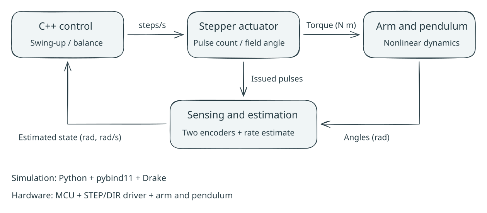
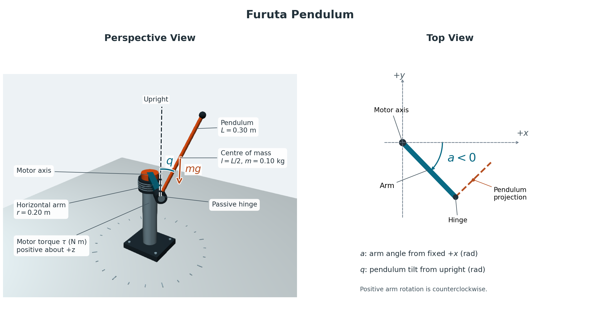
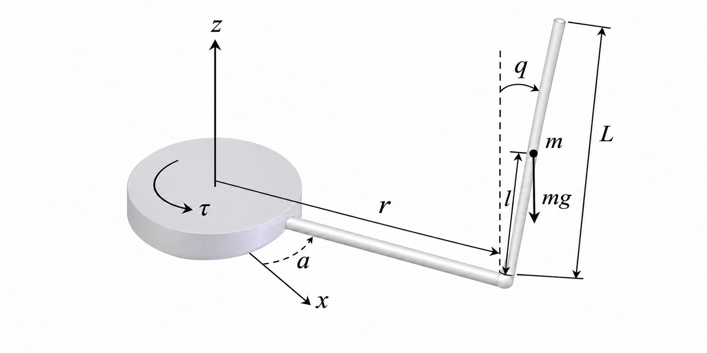

# Furuta Pendulum: Modelling and Feedback Control

This project demonstrates swing-up and feedback stabilization of a rotary inverted pendulum (Furuta pendulum) using PID control, lead compensation, Linear Quadratic Regulation (LQR), and linear Model Predictive Control (MPC).

Drake is used for nonlinear multibody simulation and linearization of the system dynamics about the upright equilibrium. A pulse-driven stepper motor model is used to represent the actuator. The resulting linear model is augmented with actuator dynamics and discretized for LQR, MPC, and Kalman observer design.

The controllers are implemented in C++, serving both as embedded firmware for the ATmega2560 and STM32 Blue Pill platforms and as a simulation backend. The implementation handles encoder feedback, control updates, and STEP/DIR pulse generation.

Each controller is evaluated under two control objectives:

1. **Pendulum stabilization:** Stabilizing the pendulum at its upright equilibrium.
2. **Pendulum stabilization with arm position control:** Stabilizing the pendulum while regulating the rotary arm to a specified angular setpoint (17° from the reference position in this project).

For each controller, the pendulum starts from rest in the downward equilibrium position (±180° relative to the upright position). An energy-based swing-up controller drives the pendulum toward the upright equilibrium, where control is switched to the respective balancing controller (PID, lead, LQR, or MPC). A disturbance is applied at t = 12 s to evaluate the controller's recovery after disturbance performance.
## Preparation

The project requires **Python 3.10+**. You also need a C++17 compiler, FFmpeg with libx264, and OpenGL/X11. On Ubuntu/Debian:

```sh
sudo apt-get install build-essential ffmpeg libgl1-mesa-dri libglx-mesa0 xvfb xauth

python3 -m venv .venv # use a Python 3.10, 3.11 or 3.12 interpreter
. .venv/bin/activate
python -m pip install -r simulation/requirements.txt
python -m pip install --no-build-isolation --no-deps .
export OPENBLAS_NUM_THREADS=1
```

To run one objective, or change the noise seed:

```sh
python -m simulation.run_demo pendulum-regulation --controller pid
python -m simulation.run_demo pendulum-arm-regulation --controller mpc --seed 43
```

Omit `--controller` to run all four. Simulation outputs go under `build/`.

Drake is pinned to [v1.23.0](https://drake.mit.edu/release_notes/v1.23.0.html), with NumPy 1.26.2 for compatibility with its binary extension.

Without a desktop X display, prefix rendering and test commands with `xvfb-run -a`.

<details>
<summary>
Additional preparation for physical hardware
</summary>
PlatformIO is included. Use ST-Link/SWD for the Blue Pill or USB for the Mega. For Mega flash commands, replace `bluepill` with `mega` and add `--port /dev/ttyACM0`.

#### **Before enabling the motor:**

Measure the plant and update [configs/base.yaml](configs/base.yaml). Simulation and empirical profiles must match your hardware. Set driver current, microstepping and travel limits; the supplied values are unmeasured defaults.

**Use a physical motor-power disconnect. `stop` only stops STEP pulses.**

##### Connections

| Signal | Arduino Mega 2560 | STM32 Blue Pill F103C8 |
|---|---|---|
| Pendulum encoder A, B | D2, D3 | PB6, PB7 |
| Arm encoder A, B | D18, D19 | PA0, PA1 |
| Driver STEP, DIR | D9, D8 | PA4, PA5 |
| Serial, 115200 baud | USB | PA9 TX, PA10 RX; 3.3 V USB-UART |
| Upload | USB bootloader | ST-Link/SWD |

Both joint encoders are required. Use digital interrupt inputs, compatible logic levels and a common signal ground. Edit [firmware/pins.h](firmware/pins.h) if wiring differs, then rebuild.

</details>

## System Architecture



Each controller outputs **signed step rate**. Both joint angles are measured and velocities are estimated.

### Geometry and Coordinates



The arm angle is $a$ and pendulum tilt is $q$. Upright is $q=0$; hanging is $q=\pi$. Drake's arm joint rotates about world $+z$, and the pendulum hinge about the arm's local $-x$. Positive tilt moves the upright pendulum in the arm's positive tangential direction.


#### Symbol Table
| Quantity | Symbol | Default |
|---|---|---:|
| Arm length | $r$ | 0.20 m |
| Pendulum length / centre-of-mass distance | $L$, $l=L/2$ | 0.30 m / 0.15 m |
| Pendulum mass | $m$ | 0.10 kg |
| Bare arm inertia about the motor axis | $J_a$ | 0.005 kg m² |
| Pendulum inertia about its hinge | $J=mL^2/3=4ml^2/3$ | 0.003 kg m² |
| Arm / hinge viscous damping | $d_a$, $d_q$ | 0.008 / 0.0007 N m s/rad |

Both links are rigid, uniform slender rods; inertia about each rod's own length is neglected. The motor housing, stand and end cap are visual geometry, not extra mass.

### Equations of Motion



Here $L$ is the full pendulum length and $l=L/2$ is the hinge-to-centre-of-mass distance. Gravity $mg$ acts downward at the centre of mass; motor torque $\tau$ acts about the vertical $z$ axis. Joint reactions, damping and the external hinge disturbance are omitted from the drawing; damping and disturbance are retained in the equations below.

The nonlinear ODE describes arm torque and an external hinge disturbance effect on both joint accelerations:

```math
M(q)\begin{bmatrix}\ddot a\\\ddot q\end{bmatrix}
=\begin{bmatrix}
\tau-d_a\dot a-2J\sin q\cos q\,\dot a\dot q+b\sin q\,\dot q^2\\
d-d_q\dot q+mgl\sin q+J\sin q\cos q\,\dot a^2
\end{bmatrix}.
```

```math
M(q)=\begin{bmatrix}
J_a+mr^2+J\sin^2q & b\cos q\\
b\cos q & J
\end{bmatrix},\quad b=mrl.
```

Only the arm is actuated. The hinge torque $d$ contains the test disturbance and added hinge losses. With zero velocity and input, both $q=0$ and $q=\pi$ are equilibria at any arm angle.

#### Derivation and Upright Linear Model

Let $\mathbf e_r(a)$ point along the horizontal arm, $\mathbf e_t(a)$ along its positive tangential direction, and $\mathbf e_z$ upward. The pendulum centre of mass is

```math
\mathbf p_c=r\mathbf e_r+l\sin q\,\mathbf e_t+l\cos q\,\mathbf e_z.
```

Combining translational and rotational energy of the slender links gives

```math
T=\tfrac12(J_a+mr^2+J\sin^2q)\dot a^2
+b\cos q\,\dot a\dot q+\tfrac12J\dot q^2,
\qquad V=mgl\cos q.
```

With $\mathcal L=T-V$, apply Euler-Lagrange to each coordinate:

```math
\frac{d}{dt}\frac{\partial\mathcal L}{\partial\dot a}
-\frac{\partial\mathcal L}{\partial a}=\tau-d_a\dot a,
\qquad
\frac{d}{dt}\frac{\partial\mathcal L}{\partial\dot q}
-\frac{\partial\mathcal L}{\partial q}=d-d_q\dot q.
```

Expanding these derivatives produces the mass matrix and ODE. The destabilising gravity term is $mgl\sin q$. Near upright, $\sin q\approx q$ and $\cos q\approx1$; products of small deviations disappear to first order. With $z=[a,q]^T$:

```math
M_0\ddot z=Gz-D\dot z+\begin{bmatrix}1\\0\end{bmatrix}\tau,
\quad M_0=M(0),\quad
G=\begin{bmatrix}0&0\\0&mgl\end{bmatrix},\quad
D=\mathrm{diag}(d_a,d_q).
```

For the mechanical state $x_m=[a,q,\dot a,\dot q]^T$:

```math
\dot x_m=A_mx_m+B_m\tau,
\quad A_m=\begin{bmatrix}0&I\\M_0^{-1}G&-M_0^{-1}D\end{bmatrix},
\quad B_m=\begin{bmatrix}0_{2\times1}\\M_0^{-1}\begin{bmatrix}1\\0\end{bmatrix}\end{bmatrix}.
```

[Drake](simulation/dynamics/drake_plant.py) builds the ODE from the two bodies and supplies the upright linearisation. The [analytical model](simulation/dynamics/furuta.py) independently checks both. The linear model is for balancing near upright and not predicting full swing-up.

### Stepper and Prediction Model

#### Stepper Motor Model

The controller commands a signed step rate $r_s$ (steps/s). Every 1.25 ms, the [motor model](simulation/hardware_model.py) integrates the rate, emits integer steps and retains the fractional remainder. For cumulative signed step count $n$,

```math
\Delta\phi=\frac{2\pi}{N_s},\qquad
\phi=\phi_0+n\Delta\phi,\qquad
u=\Delta\phi\,r_s.
```

$N_s=1600$ steps per arm revolution accounts for gearing and microstepping. The commanded field angle $\phi$ is initialized at the arm position $\phi_0$.

Motor torque is approximated by a saturated spring-damper model:

```math
\tau=\mathrm{clip}\left(
k_s(\phi-a)-c_s\dot a+\eta_\tau,
-\tau_{\max},\tau_{\max}
\right).
```

Here, $a$ is the arm angle and $\eta_\tau$ is additive torque noise. The model retains holding torque at zero step rate.

Defaults: $k_s=16$ N·m/rad, $c_s=0.48$ N·m·s/rad, $\tau_{\max}=0.65$ N·m and $|r_s|\leq4000$ steps/s. These parameters are not experimentally identified.

**Hardware:** The [MCU timer](firmware/pulses.h) generates STEP/DIR signals; torque production is left to the motor-driver system. Neither the torque model nor its saturation is implemented in firmware. Hardware deployment requires driver current limiting and actuator characterization.

#### Augmented Linear Model

Drake's torque-input model is augmented with the actuator deflection $\delta=\phi-a$, yielding a five-state model for LQR and MPC:

```math
x=\begin{bmatrix}a&q&\dot a&\dot q&\delta\end{bmatrix}^T,
\qquad x_m=\begin{bmatrix}a&q&\dot a&\dot q\end{bmatrix}^T,
```

```math
\dot\delta=u-\dot a,\qquad
\dot x_m=A_mx_m+B_m(k_s\delta-c_s\dot a).
```

The resulting system $\dot x=A_cx+B_cu$ is discretised under a zero-order hold at $h=10$ ms:

```math
x_{k+1}=Ax_k+Bu_k,
```

```math
A=e^{A_ch},\qquad B=\int_0^h e^{A_ct}B_c\,dt.
```

Implemented in [control_design.py](simulation/control_design.py), the augmented model uses commanded field angular velocity $u$ rather than shaft torque as its control input. Saturation, pulse quantisation, dry friction and noise are retained in the simulated plant but omitted from the linear prediction model.

## Controller Demonstrations

> [!NOTE]
> ###### For reproducing each controller's output
> ```
> ### Simulation
> python -m simulation.run_demo pendulum-regulation --controller <pid/lead/lqr/mpc>
> python -m simulation.run_demo pendulum-arm-regulation --controller <controller>
>
> ## Hardware
> python -m tools.build_firmware build bluepill pid --objective pendulum-regulation
> python -m tools.build_firmware build bluepill pid --objective pendulum-arm-regulation
> python -m tools.build_firmware flash bluepill pid --objective pendulum-arm-regulation
> ```
> For ATmega2560, replace `bluepill` with `mega` and add `--port /dev/ttyACM0` to the flash command. Use the serial port your board's connected to.

**Left:** pendulum regulation. **Right:** simultaneous pendulum and arm regulation. Click the video previews or plot links for full-resolution results.

All trials run for 20 s from $x_m=[0,\pi,0,0]^T$. An unannounced pendulum hinge torque of +0.06 N·m is applied over $t\in[12,12.1]$ s.

The dashed line marks controller handoff; the shaded region marks the disturbance. Pendulum tilt is plotted as absolute wrapped deviation from upright; arm angle and step rate are signed.

Plant dynamics, initial conditions, disturbance and actuator limits are identical across trials. Noise realisations differ; use identical `trial_id` and root seed for matched-noise comparisons. Results represent single trials, not statistical performance rankings.

### Shared Swing-Up

All four controllers share the [energy-based swing-up law](controllers/swing_up/energy.h):

```math
E_{\mathrm{gap}}=mgl(1-\cos q)-\frac12J\dot q^2,
```

```math
u_{\mathrm{swing}}=-g_s\sin(q+t_p\dot q)
\tanh\left(\frac{E_{\mathrm{gap}}+E_r}{E_b}\right)-k_ca.
```

Defaults: $g_s=2.5$ rad/s, $t_p=0.03$ s, $E_r=0.04$ J, $E_b=0.05$ J and $k_c=0.4$ s⁻¹. A 2 rad/s kick replaces the pumping term for the initial 0.17 s to escape downward equilibrium.

Handoff occurs when

```math
|\mathrm{wrap}(q)|<0.16,\qquad
|\hat{\dot q}|<2.5,\qquad
|\hat{\dot a}|<4,
```

with angles in rad and angular velocities in rad/s. Swing-up is not reactivated following a fall.

### PID


A PID with filtered derivative and conditional integration maps tilt error directly to step rate:

```math
\begin{aligned}
D_k&=\frac{t_DD_{k-1}+e_k-e_{k-1}}{t_D+h},\\
I_k&=\mathrm{clip}(I_{k-1}+he_k,-I_{\max},I_{\max}),\\
r_{s,k}&=\mathrm{clip}(K_pe_k+K_iI_k+K_dD_k,-r_{\max},r_{\max}).
\end{aligned}
```

Integration is inhibited when it would deepen output saturation. 

Defaults: 
$(K_p,K_i,K_d)=(5500,40000,130)$, 
$t_D=0.02$ s and 
$I_{\max}=1000$ rad·s. 

The output is in steps/s. P, PI and PD are recovered by zeroing the unused gains.

**Pendulum and arm regulation:** An outer arm PD loop generates the inner-loop tilt reference:

```math
q_{\mathrm{ref}}=-\mathrm{clip}\left(k_a(a-a_{\mathrm{ref}})+k_v\widehat{\dot a},-0.12,0.12\right),
```

```math
e_k=q_{\mathrm{meas},k}-q_{\mathrm{ref}},
\qquad(k_a,k_v)=(0.012,0.016).
```

**Pendulum regulation:** The outer PD loop is replaced by low-frequency feedback of the issued field velocity to suppress sustained arm rotation without regulating arm position:

```math
\bar u_k=\bar u_{k-1}+\frac{h}{0.2+h}(u_{\mathrm{issued},k-1}-\bar u_{k-1}),
```

```math
e_k=q_{\mathrm{meas},k}+\mathrm{clip}(0.025\bar u_k,-0.04,0.04).
```

### Lead Compensation


The compensator maps tilt error to step-rate acceleration, which is integrated into a rate command. The unsaturated error-to-rate transfer function is

```math
C(s)=\frac{k}{s}\frac{1+T_zs}{1+T_ps},
\qquad k=22000,\quad T_z=0.16\,\mathrm{s},\quad T_p=0.02\,\mathrm{s}.
```

Backward-Euler implementation:

```math
v_k=\frac{T_pv_{k-1}+k[(h+T_z)e_k-T_ze_{k-1}]}{h+T_p},
```

```math
r_{s,k}=\mathrm{clip}(r_{s,k-1}+hv_k,-r_{\max},r_{\max}).
```

Both regulation objectives use the same outer-loop architecture as PID.

### LQR


Discrete LQR minimises the infinite-horizon quadratic cost:

```math
J=\sum_{k=0}^{\infty}(\tilde x_k^TQ\tilde x_k+u_k^TRu_k),
\qquad \tilde x=x-x_{\mathrm{ref}},
```

```math
x_{\mathrm{ref}}=[a_{\mathrm{ref}},0,0,0,0]^T.
```

Solving the discrete algebraic Riccati equation yields

```math
\begin{aligned}
P&=Q+A^TPA-A^TPB(R+B^TPB)^{-1}B^TPA,\\
K&=(R+B^TPB)^{-1}B^TPA,\\
u_k&=-K(\hat x_k-x_{\mathrm{ref}}).
\end{aligned}
```

**Pendulum and arm regulation:**

```math
Q=\mathrm{diag}(3,60,0.08,1,0.2),\qquad R=0.12.
```

**Pendulum regulation:** The arm angle is excluded from the Riccati design ($K_a=0$), and the arm velocity weight is set to zero. Arm velocity feedback may remain through the coupled dynamics.

The commanded field velocity $u_k$ is converted to steps/s and saturated. Input and arm-travel constraints are not included in the LQR synthesis.

### Linear MPC


Linear MPC optimises $N=100$ independent field-velocity commands over a 1 s prediction horizon:

```math
\begin{aligned}
\min_{u_0,\ldots,u_{N-1}}\quad &
\frac12\sum_{i=0}^{N-1}
\left[(x_{i+1}-x_{\mathrm{ref}})^TQ(x_{i+1}-x_{\mathrm{ref}})+Ru_i^2\right]\\
\text{subject to}\quad &x_0=\hat x_k,\\
&x_{i+1}=Ax_i+Bu_i,\\
&|u_i|\leq\Delta\phi\,r_{\max}.
\end{aligned}
```

Only $u_0$ is applied at each sample. The weights $Q,R$ match those of LQR, with the arm position and velocity weights zeroed for pendulum-only regulation. No LQR feedback or separate terminal penalty is used.

The optimisation enforces input bounds only; arm travel and motor torque are unconstrained in prediction. Torque saturation remains active in the nonlinear plant.

**Solver:** Simulation and firmware share a single-precision C++ dual coordinate descent solver for the condensed QP, with a 24-sweep budget and $10^{-4}$ rad/s bound-residual tolerance. Non-convergence latches a controller fault until restart. Firmware additionally enforces the sample deadline. Real-time feasibility requires on-target profiling, particularly on the 16 MHz ATmega2560.


##### Additional Notes on flashing firmware
Select the regulation objective via `--objective` when flashing. Flashing does not initiate motion.

Enable `swing.enabled: true` in the empirical configuration before building. After completing the hardware-checks, position the arm at rest with the pendulum hanging downward. Send commands over serial at 115200 baud:

- `zero`: initialise encoder references.
- `swing`: initiate swing-up and subsequent stabilisation.
- `balance`: engage the balance controller directly, with the pendulum near upright.
- `stop`: disable STEP pulses.

The 12 s disturbance is simulation-only.

## Hardware Demonstration

[Hardware demonstration](https://www.youtube.com/watch?v=VB0A7SY6zuw)

**Third-year academic project - Kathmandu University, June 2024**.

The prototype implemented PID control using an ATmega2560, a NEMA 17 stepper motor, an A4988 driver and an incremental optical quadrature encoder for pendulum feedback. 

## Controller Comparison

All current firmware images require **both joint encoders**, including for swing-up, capture and travel stopping. The additional arm encoder must measure the real shaft; counting commanded motor steps is not a substitute.

| Balance controller | Purpose | Feedback used during balance | Limits |
|---|---|---|---|
| PID | Direct tilt-error feedback with filtered derivative and anti-windup | Pendulum encoder; issued-speed trim without arm target; arm angle and estimated arm speed with target | Clips step rate; conditional integration |
| Lead | Phase-lead shaping followed by rate integration | Same signal choices as PID | Clips integrated step rate |
| LQR | Joint state regulation using a local coupled model | Estimated joint angles/speeds and known field angle | Clips output; no predicted bounds |
| Linear MPC | Receding-horizon joint state regulation | Same state estimate and field angle as LQR | Predicts step-rate bounds; no travel bound in these runs |

## Implementation Details

### Sampling and Sensing

Control, motor updates and Drake's fixed-step RK5 integration run at 100 Hz, 800 Hz and 3.2 kHz, respectively.

Encoder resolutions are 4096 counts/rev (arm) and 1440 counts/rev (pendulum), post-quadrature decoding. Independent Gaussian angle noise ($\sigma=0.0005$ rad) is added before quantisation. Motor torque noise has $\sigma=0.0015$ N·m.

Additional hinge losses comprise regularised Coulomb friction and quadratic drag:

```math
d_{\mathrm{loss}}=-0.0002\tanh(\dot q/0.1)-2\times10^{-6}|\dot q|\dot q.
```

Hinge losses and torque noise are updated at 100 Hz and held between samples. Loss coefficients are phenomenological, not experimentally identified.

### State Estimation

Swing-up uses filtered encoder differences. Upon capture, estimation switches to a steady-state Kalman filter in field-relative coordinates:

```math
z=[a-\phi,q,\dot a,\dot q]^T,
```

```math
\begin{aligned}
\hat z_k^-&=F\hat z_{k-1}+G_o u_{\mathrm{issued},k-1},\\
\hat z_k&=\hat z_k^-+L_o(y_k-H\hat z_k^-).
\end{aligned}
```

Here, $y_k=[a_{\mathrm{meas}}-\phi,q_{\mathrm{meas}}]^T$. Both $\phi$ and $u_{\mathrm{issued}}$ are reconstructed from issued pulses. The arm angle is recovered as $\hat a=\hat z_1+\phi$, and actuator deflection as $\hat\delta=-\hat z_1$. Only the pendulum innovation is wrapped.

Measurement covariance accounts for quantisation and encoder noise:

```math
V_j=\frac{(2\pi/N_j)^2}{12}+\sigma_{\mathrm{encoder}}^2.
```

LQR/MPC use the full augmented state estimate; dual-objective PID/lead use estimated arm velocity. Pendulum-only PID/lead use measured tilt and issued-speed feedback, independent of the Kalman estimate. Classical controller states are primed at handoff to reduce command discontinuity.

For estimator comparisons, run `simulation.run_demo` with `--estimator difference` under identical seeds and `trial_id`. CSV logs contain true and estimated states, and `summary.json` reports post-capture pendulum velocity RMSE.

### Limits

Simulation batches pulses rather than timing individual edges. The spring-damper motor model omits electrical commutation, pole slipping and permanent missed steps. Structural flexibility, backlash, cable winding and hard-stop contact are also omitted. Plant dimensions and motor coefficients are illustrative; no system identification or torque calibration was performed.

## Credits and References

The project was completed by **[Madhuraman Dhungana](https://www.linkedin.com/in/madhuraman-dhungana-6854bb253/), [Rupesh Neupane](https://www.linkedin.com/in/rupesh-neupane-b60080208/), [Romanch Nyaupane](https://www.linkedin.com/in/romanch-nyaupane/) and [Saurav Raj Paudel](https://www.linkedin.com/in/sauravrajpaudel/_)**, Department of Electrical and Electronics Engineering, Kathmandu University, under the supervision of **Asst. Prof. Dr. Samundra Gurung**. The mechanism, firmware, tuning work and demonstration belong to that team. Repository history preserves the contributions under `Sauravrp67`(Saurav Raj Paudel).

- Cazzolato and Prime, [On the Dynamics of the Furuta Pendulum](https://doi.org/10.1155/2011/528341), 2011. Dynamics background; this repository uses the stated slender-link assumptions and its own upright-zero sign convention.
- [Drake multibody dynamics](https://drake.mit.edu/doxygen_cxx/group__multibody.html). Nonlinear plant, upright linearisation and visualisation.
- Tedrake, [Underactuated Robotics: Linear Quadratic Regulators](https://underactuated.mit.edu/lqr.html). Background on quadratic state-feedback design.
- [Hildreth, A quadratic programming procedure (1957)](https://doi.org/10.1002/nav.3800040113). Dual-coordinate method underlying the input-bound MPC solver.
